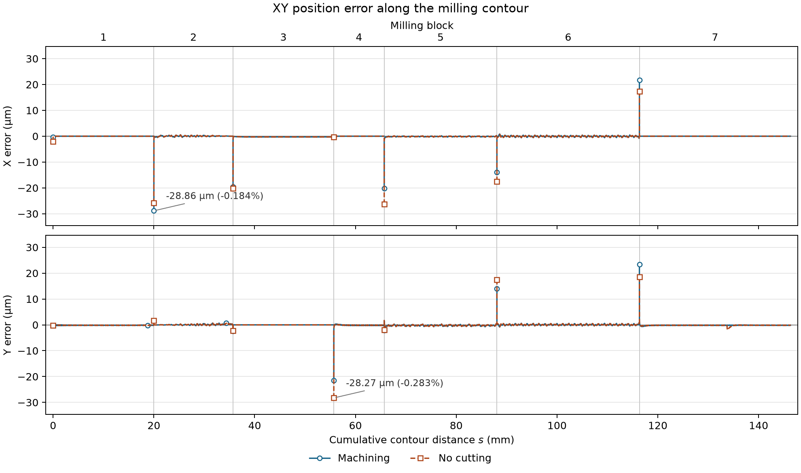

# Assignment Outcomes

## Point 1

The nominal feed velocity **along the tool path** (in curvilinear coordinates?) is calculated:

$$
V_f = f Z_f N = 955 \;\mathrm{mm/min} = 15.92 \;\mathrm{mm/s}
$$

with $N = 6,366 \;\mathrm{rpm}$. Parameters in [README.md](./README.md).

## Point 2

The nominal XY feed follows the seven blocks in the executed order of
[5ASM.MPF](data/5ASM.MPF), from `(-50, 0)` to `(-40, -20)`. On a straight
block, the signed components are

$$
(v_x,v_y)=V_f\frac{(\Delta x,\Delta y)}{\sqrt{\Delta x^2+\Delta y^2}}.
$$

On the counterclockwise arc, the center is `(-20, 0)` and the radius is
10 mm. With cumulative contour distance $s$ measured from the milling start,

$$
\phi=\frac{s-20\ \mathrm{mm}}{10\ \mathrm{mm}},\qquad
(v_x,v_y)=V_f(\sin\phi,-\cos\phi).
$$

| Block | End point (mm) | Cumulative $s$ (mm) | Nominal $(v_x,v_y)$ (mm/s) |
| --- | --- | --- | --- |
| 1 | $(-30,0)$ | 0.000–20.000 | $(15.92,0)$ |
| 2, arc | $(-20,-10)$ | 20.000–35.708 | $(0,-15.92)$ to $(15.92,0)$ |
| 3 | $(-20,10)$ | 35.708–55.708 | $(0,15.92)$ |
| 4 | $(-10,10)$ | 55.708–65.708 | $(15.92,0)$ |
| 5 | $(10,0)$ | 65.708–88.069 | $(14.24,-7.12)$ |
| 6 | $(-10,-20)$ | 88.069–116.353 | $(-11.25,-11.25)$ |
| 7 | $(-40,-20)$ | 116.353–146.353 | $(-15.92,0)$ |

The ideal traversal time is $146.353\ \mathrm{mm}/V_f \approx 9.196\ \mathrm{s}$.
The recorded milling intervals are **12.598 s with material removal** and
**9.676 s without**. Most of the difference comes from block 1, which takes
4.230 s and 1.316 s, respectively. The encoder shows a near-stop early in that
block in the material-removal run. At matching contour positions, the two
runs give nearly the same components over blocks 2–7. The median encoder speed
over the central 80% of each straight block from 3 to 7 is about **15.64 mm/s**
in both runs.

Encoder velocities are the slopes of local quadratic fits to nine samples of
G55 XY position, centered on each sample and spanning 32 ms. Each encoder
position is projected onto the line or arc assigned by
[the milling intervals](outputs/machining_intervals.csv) for comparison by distance.
The time panels use each run's own milling start and the nominal timeline
$t=s/V_f$.

Run `python3 feed_velocity.py` from this directory to regenerate the
[velocity CSV](outputs/feed_velocity.csv), [2×2 velocity comparison](plots/feed_velocity.png),
and [contour distance vs. time](plots/curvilinear_coordinate_vs_time.png).

## Point 3

The encoder records the spindle reference in machine coordinates. The tool tip
is 184.970 mm below that reference along Z. The G55 offset locates the workpiece
origin `O_P` in machine coordinates. Using the offset and tool length from
[slide 8](assets/Assignment%202%20-%20Slides.pdf#page=8), the conversion to
`workpiece coord.` is

$$
\begin{aligned}
\mathbf{p}_{\mathrm{piece}}
&= \mathbf{p}_{\mathrm{encoder}} - \mathbf{G55} - (0,0,D_1) \\
&= \mathbf{p}_{\mathrm{encoder}} + (279.872,\ 272.170,\ 189.274)\ \mathrm{mm}.
\end{aligned}
$$

The final material-removal sample at **44.432 s** is a check against the
programmed retract position. All positions and corrections are in mm.

| Axis | Encoder machine coord. | Correction | Measured workpiece coord. | Programmed workpiece coord. |
| --- | ---: | ---: | ---: | ---: |
| X | −319.87229 | +279.872 | −40.00029 | −40.000 |
| Y | −292.17017 | +272.170 | −20.00017 | −20.000 |
| Z | −139.27193 | +189.274 | +50.00207 | +50.000 |

The [converted recordings](outputs/workpiece_coordinates.csv) contain
11,109 samples with material removal and 3,932 without. The
[position-versus-time figure](plots/coordinates_vs_time.png) shows the
converted encoder positions and programmed targets, with a Z detail of each
plunge. The [3D figure](plots/trajectory_3d_origins.png) shows the
material-removal toolpath, with the dashed line joining the machine origin
`O_M` to the workpiece origin `O_P`.

The encoder Z approaches the programmed −2 mm depth in both runs. The Task 3
milling start is the first interpolated crossing of **−1.990 mm** during the
plunge. This gives **30.959 s** with material removal and **5.170 s** without.
Both runs have seven milling blocks.

## Point 4

Each encoder XY sample in the seven Task 3 milling intervals was projected
onto its assigned programmed segment or arc in G55 coordinates. The recorded
targets identify the block endpoints, and the projection supplies the nominal
point along the block. The signed geometric error for each axis is measured
minus nominal, converted to µm. The signed percentage is the same error
expressed as a percentage of the programmed block length, using arc length
for block 2. Estimating time-synchronized tracking error would require the
controller's interpolated setpoints.

The figure shows signed error along the contour, with vertical lines at the
block boundaries. Markers indicate each run's peak by absolute value in each
block. The label on each panel gives its largest peak in µm and percent.

The tables give the signed error with the largest absolute value for each
axis and block. Locations are projected distances from the start of the block.
First and last samples are flagged by recording time, since several samples
can project to the same endpoint. Ties at CSV precision use the earliest
sample.

### X position error

| Block | With material removal | Without material removal |
| ---: | --- | --- |
| 1 | -0.28 µm (-0.00140%) at 0.000 mm (first sample) | -2.02 µm (-0.01010%) at 0.000 mm (first sample) |
| 2 | -28.86 µm (-0.18373%) at 0.000 mm (first sample) | -25.87 µm (-0.16469%) at 0.000 mm (first sample) |
| 3 | -19.49 µm (-0.09745%) at 0.000 mm (first sample) | -20.25 µm (-0.10125%) at 0.000 mm (first sample) |
| 4 | -0.28 µm (-0.00280%) at 0.000 mm (first sample) | -0.30 µm (-0.00300%) at 0.000 mm |
| 5 | -20.14 µm (-0.09007%) at 0.000 mm (first sample) | -26.29 µm (-0.11757%) at 0.000 mm (first sample) |
| 6 | -13.96 µm (-0.04936%) at 0.006 mm (first sample) | -17.49 µm (-0.06184%) at 0.008 mm (first sample) |
| 7 | +21.66 µm (+0.07220%) at 0.000 mm (first sample) | +17.42 µm (+0.05807%) at 0.000 mm (first sample) |

### Y position error

| Block | With material removal | Without material removal |
| ---: | --- | --- |
| 1 | -0.23 µm (-0.00115%) at 18.767 mm | -0.24 µm (-0.00120%) at 0.007 mm |
| 2 | +0.73 µm (+0.00464%) at 14.311 mm | +1.71 µm (+0.01089%) at 0.000 mm |
| 3 | -2.41 µm (-0.01205%) at 0.000 mm | -2.31 µm (-0.01155%) at 0.000 mm |
| 4 | -21.44 µm (-0.21440%) at 0.000 mm (first sample) | -28.27 µm (-0.28270%) at 0.000 mm (first sample) |
| 5 | -2.07 µm (-0.00927%) at 0.040 mm | -2.01 µm (-0.00898%) at 0.008 mm |
| 6 | +13.96 µm (+0.04936%) at 0.006 mm (first sample) | +17.49 µm (+0.06184%) at 0.008 mm (first sample) |
| 7 | +23.36 µm (+0.07787%) at 0.000 mm (first sample) | +18.49 µm (+0.06163%) at 0.000 mm (first sample) |

The largest absolute component errors were **28.86 µm** with material removal
(block 2, X) and **28.27 µm** without material removal (block 4, Y). Both
occurred at the first sample of their block. The run with the higher peak
varied by axis and block, and 19 of the 28 peaks were at block starts.

Run `python3 position_error.py` from this directory to regenerate the figure,
the tables, and the [per-sample CSV](outputs/position_error.csv).

## Point 5 - Conclusions about the machining error

The [position error plot](./plots/position_error.png) shows the following trends.

* The machining and no-cutting runs show similar X and Y error traces. The run
  with the larger peak varies by axis and block. These two runs show no
  consistent increase in encoder-based XY contour error during cutting.
* Small ripples are visible in the circular arc (block 2) and the two diagonal
  straight-line segments (blocks 5 and 6). Over the middle 80% of these blocks,
  the peak-to-peak errors range from **0.5 to 1.1 µm** across both runs.
* **19 of the 28** per-axis peaks occur at the first sample of a block. The
  errors generally return toward zero after these spikes, indicating that the
  largest deviations are localized near block transitions.
* Across both axes and both runs, the absolute error stays below **0.3% of
  the programmed block length**. The largest absolute component errors are
  **28.86 µm** with material removal (X, block 2) and **28.27 µm** without
  material removal (Y, block 4).
