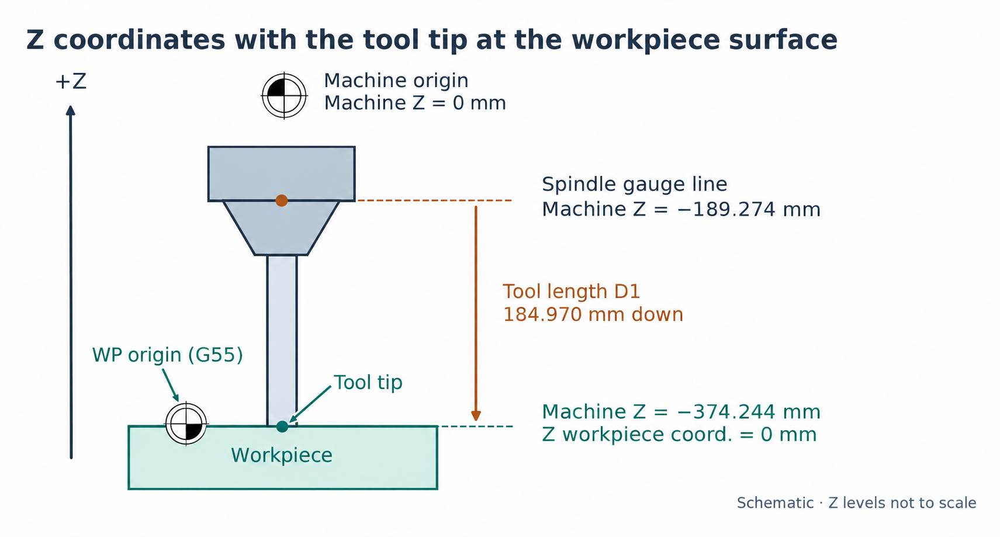

# Assignment Outcomes

## Point 1

The nominal feed velocity **along the tool path** (in curvilinear coordinates?) is calculated:

$$
V_f = f Z_f N = 955 \;\mathrm{mm/min} = 15.92 \;\mathrm{mm/s}
$$

with $N = 6,366 \;\mathrm{rpm}$. Parameters in [README.md](./README.md).

## Point 2

The nominal XY feed follows the seven blocks in the executed order of
[5ASM.MPF](data/5ASM.MPF), from `(-50, 0)` to `(-40, -20)`. On a straight
block, the signed components are

$$
(v_x,v_y)=V_f\frac{(\Delta x,\Delta y)}{\sqrt{\Delta x^2+\Delta y^2}}.
$$

On the counterclockwise arc, the center is `(-20, 0)` and the radius is
10 mm. With cumulative contour distance $s$ measured from the milling start,

$$
\phi=\frac{s-20\ \mathrm{mm}}{10\ \mathrm{mm}},\qquad
(v_x,v_y)=V_f(\sin\phi,-\cos\phi).
$$

| Block | End point (mm) | Cumulative $s$ (mm) | Nominal $(v_x,v_y)$ (mm/s) |
| --- | --- | --- | --- |
| 1 | $(-30,0)$ | 0.000–20.000 | $(15.92,0)$ |
| 2, arc | $(-20,-10)$ | 20.000–35.708 | $(0,-15.92)$ to $(15.92,0)$ |
| 3 | $(-20,10)$ | 35.708–55.708 | $(0,15.92)$ |
| 4 | $(-10,10)$ | 55.708–65.708 | $(15.92,0)$ |
| 5 | $(10,0)$ | 65.708–88.069 | $(14.24,-7.12)$ |
| 6 | $(-10,-20)$ | 88.069–116.353 | $(-11.25,-11.25)$ |
| 7 | $(-40,-20)$ | 116.353–146.353 | $(-15.92,0)$ |

The ideal traversal time is $146.353\ \mathrm{mm}/V_f \approx 9.196\ \mathrm{s}$.
The recorded milling intervals are **12.598 s with material removal** and
**9.676 s without**. Most of the difference comes from block 1, which takes
4.230 s and 1.316 s, respectively. The encoder shows a near-stop early in that
block in the material-removal run. At matching contour positions, the two
runs give nearly the same components over blocks 2–7. The median encoder speed
over the central 80% of each straight block from 3 to 7 is about **15.64 mm/s**
in both runs.

Encoder velocities are the slopes of local quadratic fits to nine samples of
G55 XY position, centered on each sample and spanning 32 ms. Each encoder
position is projected onto the line or arc assigned by
[the milling intervals](outputs/machining_intervals.csv) for comparison by distance.
The time panels use each run's own milling start and the nominal timeline
$t=s/V_f$.

Run `python3 feed_velocity.py` from this directory to regenerate the
[velocity CSV](outputs/feed_velocity.csv), [2×2 velocity comparison](plots/feed_velocity.png),
and [contour distance vs. time](plots/curvilinear_coordinate_vs_time.png).

## Point 3

The encoder records the spindle reference in machine coordinates. The tool tip
is 184.970 mm below that reference along Z. The G55 offset locates the workpiece
origin `O_P` in machine coordinates. Using the offset and tool length from
[slide 8](assets/Assignment%202%20-%20Slides.pdf#page=8), the conversion to
`workpiece coord.` is

$$
\begin{aligned}
\mathbf{p}_{\mathrm{piece}}
&= \mathbf{p}_{\mathrm{encoder}} - \mathbf{G55} - (0,0,D_1) \\
&= \mathbf{p}_{\mathrm{encoder}} + (279.872,\ 272.170,\ 189.274)\ \mathrm{mm}.
\end{aligned}
$$

The final material-removal sample at **44.432 s** is a check against the
programmed retract position. All positions and corrections are in mm.

| Axis | Encoder machine coord. | Correction | Measured workpiece coord. | Programmed workpiece coord. |
| --- | ---: | ---: | ---: | ---: |
| X | −319.87229 | +279.872 | −40.00029 | −40.000 |
| Y | −292.17017 | +272.170 | −20.00017 | −20.000 |
| Z | −139.27193 | +189.274 | +50.00207 | +50.000 |

The [converted recordings](outputs/workpiece_coordinates.csv) contain
11,109 samples with material removal and 3,932 without. The
[position-versus-time figure](plots/coordinates_vs_time.png) shows the
converted encoder positions and programmed targets, with a Z detail of each
plunge. The [3D figure](plots/trajectory_3d_origins.png) shows the
material-removal toolpath, with the dashed line joining the machine origin
`O_M` to the workpiece origin `O_P`.

The encoder Z approaches the programmed −2 mm depth in both runs. The Task 3
milling start is the first interpolated crossing of **−1.990 mm** during the
plunge. This gives **30.959 s** with material removal and **5.170 s** without.
Both runs have seven milling blocks.
